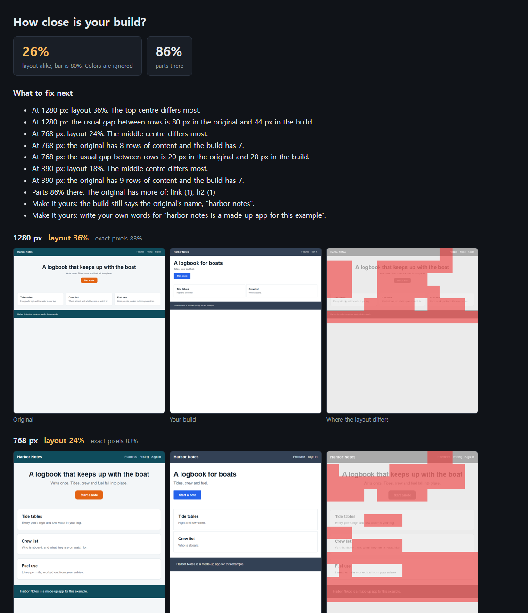
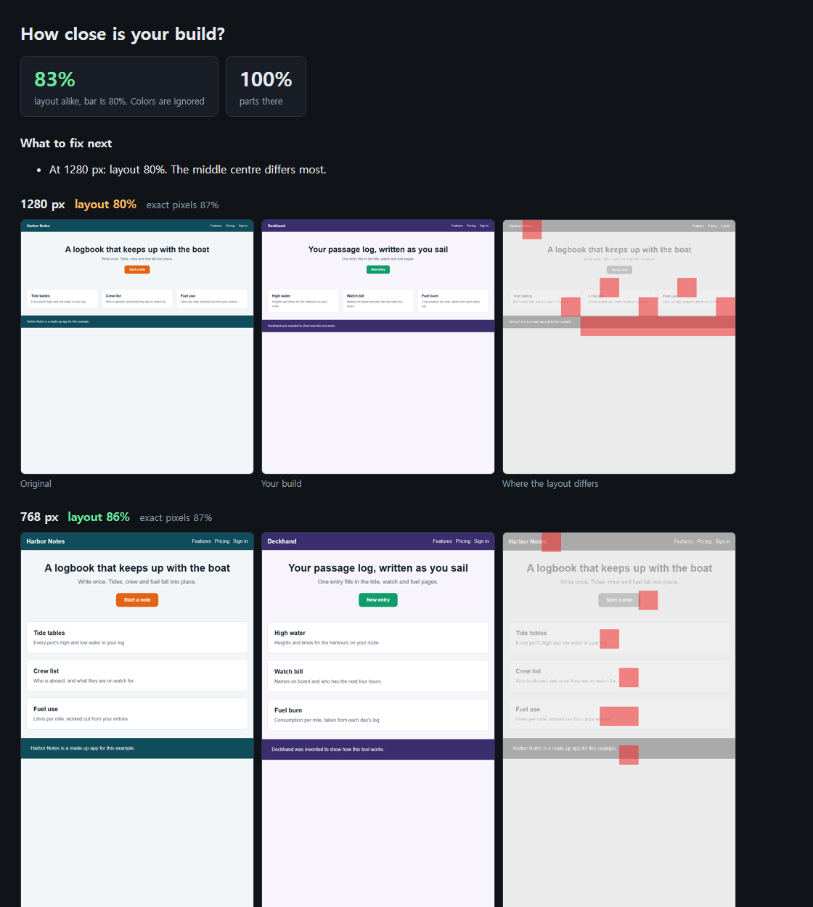

<div align="center">

# rebuild-proof

**Ten free skills that rebuild any web app as your own, and prove how close you got.**

[Replica](https://github.com/Jakeschincariol/replica-skill) scores a clone with a slow pure-Python tool. [BAMA](https://github.com/daveebbelaar/bama) only builds Mac apps. This runs the same layout math over 30 times faster on any machine, then tells you which words are still not yours.

Works with **Claude Code** and **Codex**.

 



<sub>Real report from `python rebuild_proof.py demo`. The pages are made up and ship with the repo.</sub>

</div>

## Install in Claude Code or Codex

```bash
/plugin marketplace add Dodai0419/rebuild-proof
/plugin install rebuild-proof@rebuild-proof
```

```bash
git clone https://github.com/Dodai0419/rebuild-proof && cp -r rebuild-proof/skills/* ~/.codex/skills/
```

Or copy `AGENTS.md` to your project root. Then ask:

> "Rebuild the pricing page of my favourite note app in my own brand, and show me how close it gets."

## Quick start

You need Python 3. Capturing pages also needs Edge or Chrome. The demo does not.

```bash
git clone https://github.com/Dodai0419/rebuild-proof && cd rebuild-proof
pip install pillow numpy
python rebuild_proof.py demo
```

```text
first try: layout 26% (bar 80%). What to fix:
  - At 1280 px: layout 36%. The top centre differs most.
  - At 1280 px: the usual gap between rows is 80 px in the original and 44 px in the build.
  - At 768 px: layout 24%. The middle centre differs most.
  - At 768 px: the original has 8 rows of content and the build has 7.

fixed build, own name, words and colors: layout 83%, exact pixels 86%, good enough, 1 left
features: 86%, must-haves 3/3, overall 85%: shippable
  - should: Crew list (partial)
  - could: Fuel use (no)
```

On a real app:

```bash
python rebuild_proof.py capture https://example.com/ --out captures/original/home
python rebuild_proof.py stories captures/original --out docs/screens
python rebuild_proof.py capture http://localhost:3000/ --out captures/build/home
python rebuild_proof.py compare captures/original/home captures/build/home --out proof/home
python rebuild_proof.py parity docs/screens/features.csv --layout proof/home/report.json
```

## What you get

### A score that does not punish your brand

The fixed build below has a different name, different words and different colors, and it still passes overall. One width sits just under the bar at 80%, and the report says so. Layout compares where things are, not what color they are.



| Build | Layout | Exact pixels | Passes |
|-------|--------|--------------|--------|
| First try: missing a card, wrong spacing | 26% | 82% | No |
| Fixed, in its own name, words and colors | 83% | 86% | Yes |

Look at the pixel column: the bad first try and the good rebuild score nearly the same. That is why pixels are not the number to chase.

### A list of what to fix, in plain words

```text
At 768 px: the original has 8 rows of content and the build has 7.
At 1280 px: the usual gap between rows is 80 px in the original and 44 px in the build.
Parts 86% there. The original has more of: link (1), h2 (1)
```

### A check that it is really yours

Rebuild what an app does, never what it owns. `compare` finds the original's name in your build, and any run of six or more words taken as they are:

```text
Make it yours: the build still says the original's name, "harbor notes".
Make it yours: write your own words for "harbor notes is a made up app for this example".
```

It reads visible text only, so it cannot see copied logos, photos or code, and it is not a trademark or legal check.

### Exact values from a screenshot

```bash
python rebuild_proof.py measure examples/captures/original/screenshot-1280.png
```

```text
size 1280 x 1400, background #f3f6f8, colors #f3f6f8 (82%), #0f4c5c (9%)
each row's top, height, left and right; the usual gap; the left edge
```

The real output is JSON, so an agent can read it directly. Measuring beats guessing when a page looks close but not right.

### A backlog and a feature matrix from captures

```bash
python rebuild_proof.py stories captures/original --out docs/screens
```

```markdown
### S-004 Start a note
As the user, on Harbor Notes, I use "Start a note".
Acceptance:
- [manual] Write what should happen, after trying it in the original.
- [snap] The "Start a note" control shows at all widths.
Status: todo
```

It also writes `INDEX.md` and a `features.csv` ready for the parity score.

### A straight answer on "is it ready?"

```bash
python rebuild_proof.py parity examples/features.csv
```

```text
features 86%, must-haves 3/3: shippable
  - should: Crew list (partial) [logbook]
  - could: Fuel use (no) [logbook]
```

Must counts 3, should 2, could 1, partial half. A missing must-have is never shippable, whatever the score. Exit code 1 means not shippable, so an agent can loop on it.

## The ten skills

| Skill | Job |
|-------|-----|
| `rebuild-proof` | Finds where you are and picks the next skill |
| `app-recon` | Captures every screen at three widths |
| `app-stories` | Turns captures into a backlog and a feature matrix |
| `app-measure` | Reads exact colors, rows and spacing from a screenshot |
| `app-rebuild` | Builds screen by screen, comparing after each |
| `app-compare` | Scores the layout and lists what to fix |
| `app-parity` | Scores the features and lists what to build next |
| `app-own-it` | Replaces the original's name and words with yours |
| `app-better` | Turns the original's user complaints into your reason to exist |
| `app-regress` | Catches what changed between two versions of your build |

The tool does the measuring. The skills tell your agent what to do with the numbers.

## Commands

| Command | Meaning | Exit code |
|---------|---------|-----------|
| `capture TARGET [--out DIR] [--widths 1280,768,390]` | Screenshots, visible text and outline from a URL or HTML file | 0, or a message |
| `measure IMAGE` | Colors, rows and spacing, as JSON | 0 |
| `stories DIR [--out DIR]` | `INDEX.md`, `STORIES.md`, `features.csv` | 0 |
| `compare ORIGINAL BUILD [--out DIR] [--bar 80]` | `report.html` and `report.json` | 1 under the bar |
| `parity FEATURES [--layout REPORT...]` | Feature score and what is missing | 1 if not shippable |
| `demo [--out DIR]` | Runs on the bundled pages, no browser | 0 |

## The problem

- Agents rebuild a page, say it looks right, and you only find out it does not by opening both side by side.
- Pixel diffs punish you for your own brand and reward a page that is simply mostly background.
- Clones drift into copying: the original's name and sentences stay in the build unless something checks.

## The solution

| Idea | Fixes |
|------|-------|
| **Layout score that ignores color** | A rebrand is not counted as a mistake |
| **Only cells with something in them count** | Empty margins cannot pad the number |
| **A fix list in plain words** | The agent knows what to do next, not only that it failed |
| **Feature parity with weighted must-haves** | A pretty page with no features cannot ship |
| **Borrowed-words check** | The build stops saying what the original says |

## Why this instead of Replica or BAMA

| | [Replica](https://github.com/Jakeschincariol/replica-skill) | [BAMA](https://github.com/daveebbelaar/bama) | rebuild-proof |
|---|---|---|---|
| Builds | **Any app, with its backend, deploy and launch skills** | **Native macOS apps** | Web apps |
| Skills | **11** | **21** | 10 |
| Layout score | Yes, about 11-14 s per comparison here | Pixel diff only, needs a Mac | The same numbers, about 0.2-0.4 s per comparison |
| Own screen capture | No: you bring screenshots | Mac app windows | Web pages at three widths |
| Fix list from measured rows and gaps | No | By hand, with its measuring script | **Yes** |
| Checks your words are your own | Name sweep, with `replica-brand` | No | Name and six-word runs |
| Backend, payments, deploy, store listing | **Yes** | **Some** | No |
| Needs | **Python only** | **macOS 26, Swift 6.2** | Python, Pillow, numpy |

Choose Replica for the whole road to a launched business, BAMA for a Mac app, and this one for a fast, checkable rebuild of a web front end.

## Benchmarks

Six layout comparisons on the bundled captures, at 1280, 768 and 390 px:

| | Replica `imgdiff.py` | rebuild-proof |
|---|---|---|
| Six comparisons | 68-83 s | 0.9-2.1 s |
| Same scores | | All six equal to 0.1 |
| Lines of code | 684 (`imgdiff.py`, `parity.py`) | 506 (`rebuild_proof.py`, which also captures, measures and writes stories) |
| Dependencies | 0 | Pillow, numpy |

A whole `compare` with its report at three widths takes 2.7-5.2 s.

```bash
python bench/bench.py
```

Windows 11, Python 3.11, three to five runs, on a machine at about 98% CPU from other work, so these ranges are wide. Replica was run on the same captures, one process per comparison, so its time includes starting Python, which is a small share. Its speed is the cost of having no dependencies, which is a fair choice for a tool anyone can paste in.

## Testing and limits

- 31 tests, including the six upstream scores as fixed values, Replica's parity weights, a real browser capture, and CLI exit codes.
- `app-recon` is only as good as what it can reach. It does not click, sign in or scroll inside a page, so bring your own screenshots for those screens, named `screenshot-<width>.png`.
- Tested on made-up pages and on this machine's Edge. It has not been run against a large production app.
- The layout score sees edges, not meaning. A page with the same shape and a wrong feature can score well: that is what the parity step is for.
- The skills are instructions for your agent, and only the commands above were run. `app-better` and `app-rebuild` were not exercised end to end.

```bash
python -m unittest discover -s tests -q
```

## Use it fairly

Rebuild what an app does, never what it owns: not its code, logo, copy or content. Capture only pages you are allowed to view, and do not bypass a login, a paywall or a block. Some sites' terms limit automated access, and some layouts and names are protected. This tool is not legal advice.

## Inspired by

- [Jakeschincariol/replica-skill](https://github.com/Jakeschincariol/replica-skill) (MIT): the layout diff and parity score, ported to numpy, and the rule of rebuilding what an app does, never what it owns.
- [daveebbelaar/bama](https://github.com/daveebbelaar/bama) (MIT): the screens-to-stories flow, measuring instead of guessing, and comparing after each screen.

## Roadmap

- [ ] Capture screens behind a click, from a short script of steps
- [ ] Compare one region at a time, as BAMA's script does
- [ ] A per-area view in the parity report

## License

MIT. See `LICENSE` for the notices on ported work.
